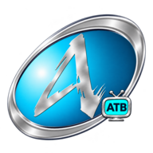
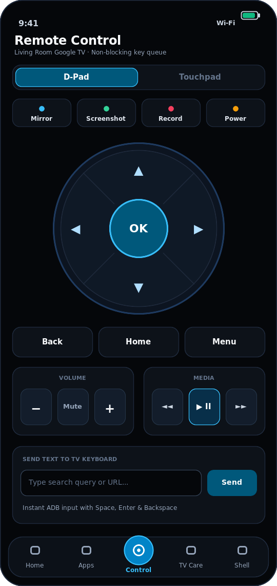
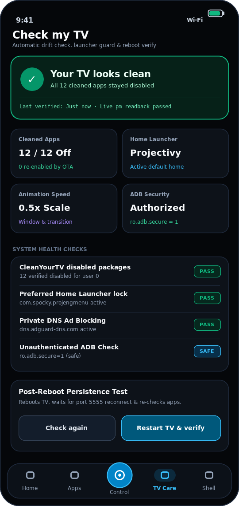
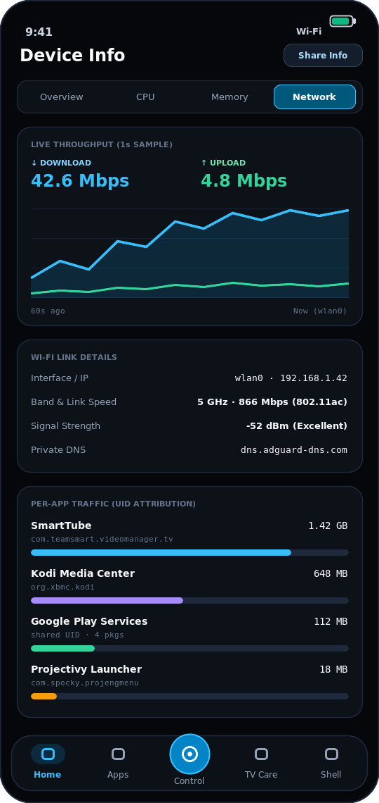

<div align="center">
  

  <h1>A4 TV Bridge</h1>

  <p>
    <strong>Local-network ADB controller, CleanYourTV auto-debloater, live telemetry dashboard, file manager, and theme studio for Android TV, Google TV, and compatible Fire TV devices.</strong>
  </p>

  <p>
    <a href="https://github.com/RatherAsif04/A4-TV-Bridge/releases/latest">
      
    </a>
    
    <a href="LICENSE">
      
    </a>
    <a href="https://github.com/RatherAsif04/A4-TV-Bridge/actions">
      
    </a>
  </p>

  <p>
    <a href="#screenshots">Screenshots</a> &bull;
    <a href="#about">About</a> &bull;
    <a href="#all-features">All Features</a> &bull;
    <a href="#how-to-use">How to Use</a> &bull;
    <a href="docs/FEATURES.md">Full Feature Guide</a> &bull;
    <a href="CHANGELOG.md">Changelog</a> &bull;
    <a href="SECURITY.md">Security</a>
  </p>
</div>

---

## Screenshots

<table>
  <tr>
    <td align="center" width="33%">
      <br />
      <sub><strong>Dashboard (Dark Mode)</strong><br />Live TV storage, CPU/RAM/Network tiles &amp; quick tools</sub>
    </td>
    <td align="center" width="33%">
      <br />
      <sub><strong>Remote &amp; Control</strong><br />D-Pad/Touchpad, volume, media, keyboard &amp; capture</sub>
    </td>
    <td align="center" width="33%">
      <br />
      <sub><strong>Clean Up TV</strong><br />Auto-matched 518 CleanYourTV lists &amp; Safety Guards</sub>
    </td>
  </tr>
  <tr>
    <td align="center" width="33%">
      <br />
      <sub><strong>Check my TV</strong><br />Drift detection, launcher check &amp; post-reboot verify</sub>
    </td>
    <td align="center" width="33%">
      <br />
      <sub><strong>Device Info (Network)</strong><br />1s live throughput chart, Wi-Fi link &amp; per-app traffic</sub>
    </td>
    <td align="center" width="33%">
      <br />
      <sub><strong>Home &amp; Themes (Light Mode)</strong><br />Launcher switcher &amp; 4 clean-room 1080p themes</sub>
    </td>
  </tr>
</table>

---

## About

**A4 TV Bridge** turns any Android phone or tablet (Android 8.0+) into a fast, private, zero-tracking local-network ADB command center for your television.

- **Direct Local Control**: Commands, files, captures, and telemetry travel directly between your phone and your TV over your local network — no cloud relay, no account login, and no analytics.
- **Built for Safety**: Every destructive or system-modifying workflow includes live ADB readback verification, boot-loop protection (`CORE_RE` + Home/HDMI/Wi-Fi setup guards), and one-tap undo in **Restore**.
- **Independent Open Source**: Built and maintained by [RatherAsif04](https://github.com/RatherAsif04) under the [MIT License](LICENSE), with community TV debloat profiles powered by [CleanYourTV](https://github.com/Gathin23/cleanyourtv) (MIT).

---

## All Features

> For technical details, ADB commands, and every screen breakdown, see **[docs/FEATURES.md](docs/FEATURES.md)**.

### 1. Fast TV Discovery, TLS Pairing & Multi-TV Management
- **mDNS / Network Discovery**: Automatically scans your LAN for Wireless Debugging (`_adb-tls-connect._tcp`) and legacy ADB (`_adb._tcp`) services.
- **Android 11+ Wireless Pairing**: Built-in TLS pairing flow supporting separate pairing port + 6-digit pairing code and connection port.
- **Direct IP & Saved TVs**: Connect via IP:port (including legacy port `5555`), save multiple TVs, rename them, and switch TVs in one tap without losing session state on rotation or theme switches.

### 2. Clean Up TV (Powered by CleanYourTV — 518 Device Lists)
- **Automatic TV Profile Matching**: Reads TV `manufacturer`, `brand`, `model`, `device`, and `board` properties on connect and automatically matches against **518 community device profiles** (`profiles.json` + `profiles_meta.json`, synced from `Gathin23/cleanyourtv`) with a universal consensus fallback and searchable manual picker.
- **Boot-Loop & Lock-Out Safety Guards**: Automatically protects active Home launchers, HDMI/AV & `TvInputService` packages, `setupwraith` Wi-Fi owners, Settings, keyboards, and critical Android core packages (`CORE_RE` with `CORE_OK` allowlist).
- **1-Tap Batch Disable & Live Readback**: Shows community disable/keep counts, executes batch `pm disable-user --user 0` with live progress, and immediately verifies every package via `pm list packages -e --user 0`.
- **Undoable UI Animation Speedup**: Switch window, transition, and animator scales between `1.0x`, `0.5x` (Snappy), and `0x` (Instant) — restorable anytime in **Restore**.

### 3. Check my TV & Restore
- **Automatic Drift Detection**: Checks whether any previously cleaned bloatware was silently re-enabled by an OTA update and lets you re-disable drifted packages in one tap.
- **Launcher & ADB Security Audit**: Verifies your preferred Home launcher stayed active and warns if `ro.adb.secure=0` (unauthenticated network ADB) is exposed on your TV.
- **Post-Reboot Persistence Verification**: Reboots the TV, waits for port `5555` auto-reconnect, and re-runs the verification scan automatically.
- **1-Tap Restore**: Re-enable individual apps or **Turn all apps back on**, and restore original animation scales with a single tap.

### 4. Remote Control, Screen Mirror & Capture
- **Non-Blocking Key Queue**: Dedicated coroutine channel guarantees rapid D-pad presses never drop or cause layout bounce.
- **D-Pad & Touchpad Modes**: Full directional navigation, OK, Back, Home, Menu, Volume +/-/Mute, Power, Media playback controls, and instant **Send Text** to the TV keyboard.
- **Interactive Screen Mirror**: Refreshed TV frame view supporting direct taps, swipes, and directional buttons.
- **Screenshot & Screen Record**: Capture crisp PNG screenshots or silent MP4 recordings (with automatic bitrate fallback on older Android TV devices) directly to your phone.

### 5. Apps, Split APKs & 1-Click Verified App Installer
- **App Manager**: Segmented `Installed` / `Built-in` / `Running` views with search, launch, force-stop, clear cache/data, disable/enable, and uninstall.
- **APK & Split-APK Sideloading**: Install single `.apk` files or multi-part split APK bundles directly from phone storage using staged `pm install-create` sessions.
- **1-Click App Install**: Fetches official GitHub releases for popular TV apps (e.g., SmartTube, Projectivy Launcher, Kodi, FLauncher), matches your TV's ABI, and verifies the published **SHA-256 checksum** and **expected package ID** before installing.

### 6. File Manager & Send Files
- **Full TV Storage Browser**: Navigate `/sdcard` on your TV, create folders, rename, move, delete, upload from phone, or download files back to your phone (compatible with Android 8–15 Toybox).
- **Quick Send Files**: Push files directly into TV `Downloads`, `Movies`, `Music`, `Pictures`, or `Documents` under an organized `A4TVBridge/` subfolder.

### 7. Live Device Info & Network Telemetry
- **4 Diagnostic Tabs**: `Overview` (model, OS, build, uptime, storage), `CPU` (utilization, core clocks, temperature when exposed), `Memory` (RAM & swap breakdown), and `Network` (1-second live Down/Up throughput chart, Wi-Fi band/RSSI/link speed, and per-app UID traffic attribution).
- **Share Device Info**: Export a clean text summary of your TV's hardware and software profile in one tap.

### 8. Home Screen Launchers, 1080p Theme Studio & Block Ads
- **Launcher Switcher**: View all real TV launchers (filtering out `FallbackHome`, `setupwraith`, and `factorytest`), switch your default Home launcher, and remember it for **Check my TV**.
- **Clean-Room 1080p Theme Studio**: Generates 4 crisp `1920×1080` PNG wallpapers on-device (`Nordic Slate`, `Obsidian Gold`, `Deep Ocean`, `Emerald Dusk`) and pushes them directly to your TV — zero external downloads.
- **Block Ads (Private DNS)**: One-tap configuration of Android Private DNS (`dns.adguard-dns.com`, `NextDNS`, `Control D`, or custom DoT hostname) to cut ad traffic network-wide on Android 9+ TVs.

### 9. ADB Shell Terminal, Themes & Automatic In-App Updates
- **Interactive ADB Shell**: Run non-interactive shell commands on your TV with full stdout/stderr output, exit code badge, and anchored bottom dock.
- **True Black Dark Mode & Clean Light Mode**: Instant theme switching (System / Light / Dark) with crisp contrast across dialogs, inputs, dropdowns, and bottom sheets.
- **Automatic In-App GitHub Releases Updater**: Checks `RatherAsif04/A4-TV-Bridge` releases silently on startup (throttled to once every 6 hours) and on demand in **About → Check for updates**, verifies APK SHA-256 and package ID (`dev.a4tvbridge.app`), shows live download progress, and launches Android's package installer in one tap.

---

## How to Use

> See the complete step-by-step manual with troubleshooting in **[docs/USAGE.md](docs/USAGE.md)**.

1. **Install the App**: Download `A4-TV-Bridge-1.4.2-release.apk` from the [Latest Release](https://github.com/RatherAsif04/A4-TV-Bridge/releases/latest) on your Android phone or tablet (Android 8.0+) and install it.
2. **Enable Debugging on Your TV**:
   - Open **Settings → System → About** on your TV and click **Android TV OS build** 7 times to unlock Developer Options.
   - Open **Settings → System → Developer options** and turn on **Wireless debugging**, **Network debugging**, or **USB/ADB debugging**.
3. **Connect Your TV**:
   - Make sure your phone and TV are on the same local Wi-Fi/LAN network.
   - Open **A4 TV Bridge**, tap **Connect your TV**, and choose **Find TVs on this network**, **Pair with a code** (Android 11+ Wireless Debugging), or **Enter TV address** (e.g., `192.168.1.42:5555`).
   - Approve the **Allow debugging** prompt on your TV screen.
4. **Clean Up & Verify**:
   - Open **TV Care → Clean Up TV** — your TV model is auto-matched against the 518 CleanYourTV lists with Safety Guards enabled. Review the pre-selected bloatware and tap **Turn off selected apps**.
   - Open **TV Care → Check my TV** anytime (or run **Restart TV & verify**) to confirm every cleaned app stayed off and your preferred launcher remained active.
5. **Stay Up to Date**:
   - Open **About → Check for updates** (or tap the update prompt when a new GitHub Release is published) to download, verify, and install future releases in one tap.

---

## Building from Source & Automated GitHub Releases

### Build Locally

Requirements: **JDK 21**, **Android SDK Platform 37.0** (`compileSdk = 37`), **Build Tools 37.0.0**, and **Gradle 9.3.1** (included via `./gradlew`).

```sh
export ANDROID_HOME=/path/to/android-sdk
./gradlew :app:testDebugUnitTest :app:assembleDebug :app:assembleRelease
```

### Automated GitHub Actions CI/CD

Every push to `main` runs `.github/workflows/build-apk.yml`:
1. Runs Kotlin unit tests (`:app:testDebugUnitTest`).
2. Builds `A4-TV-Bridge-<version>-debug.apk` and `A4-TV-Bridge-<version>-release.apk` (automatically `zipalign`ed and signed/verified with `apksigner` when repository secrets `SIGNING_KEY_BASE64`, `SIGNING_KEY_ALIAS`, `SIGNING_STORE_PASSWORD`, and `SIGNING_KEY_PASSWORD` are set).
3. Generates `SHA256SUMS.txt` and automatically publishes the GitHub Release tagged `v<versionName>`, which the in-app updater detects automatically.

---

## Licenses & Attribution

- **A4 TV Bridge**: Copyright © RatherAsif04 and A4 TV Bridge contributors — licensed under the **[MIT License](LICENSE)**.
- **CleanYourTV Device Profiles**: Bundled debloat lists (`app/src/main/assets/profiles.json` and `profiles_meta.json`, 518 profiles) synced from [Gathin23/cleanyourtv](https://github.com/Gathin23/cleanyourtv) under the **MIT License**.
- **Third-Party Libraries**: See **[THIRD_PARTY_NOTICES.md](THIRD_PARTY_NOTICES.md)** for full notices (`kadb`, `Conscrypt`, `AndroidX`, `Kotlinx Coroutines`, `CleanYourTV`).
