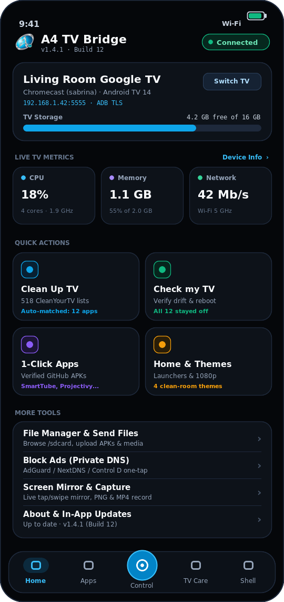
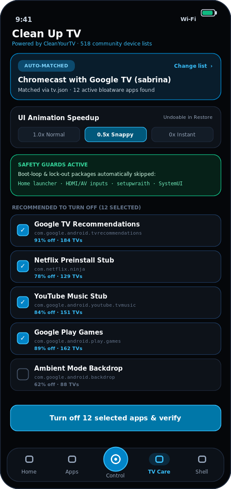
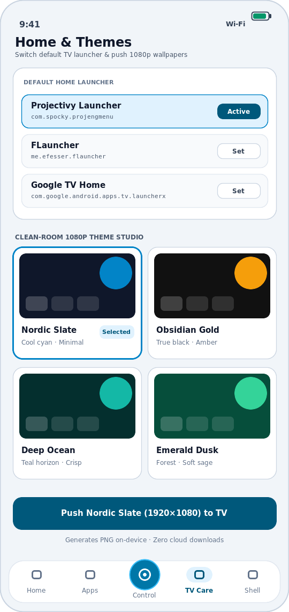

<div align="center">
  

  <h1>A4 TV Bridge</h1>

  <p>
    <strong>Private, local-network ADB command center for Android TV, Google TV, and compatible Fire TV — featuring a live TV scanner, CleanYourTV auto-debloater, real-time telemetry, app &amp; file manager, Private DNS ad blocker, and 1080p theme studio.</strong>
  </p>

  <p>
    <a href="https://github.com/RatherAsif04/A4-TV-Bridge/releases/latest">
      
    </a>
    <a href="https://github.com/RatherAsif04/A4-TV-Bridge/releases">
      
    </a>
  </p>

  <p>
    
    <a href="LICENSE">
      
    </a>
    <a href="https://github.com/RatherAsif04/A4-TV-Bridge/actions">
      
    </a>
  </p>

  <p>
    <a href="#screenshots">Screenshots</a> &bull;
    <a href="#about">About</a> &bull;
    <a href="#all-features">All Features</a> &bull;
    <a href="#device-matrix">Device Matrix</a> &bull;
    <a href="#how-to-use">How to Use</a> &bull;
    <a href="docs/FEATURES.md">Full Feature Guide</a> &bull;
    <a href="CHANGELOG.md">Changelog</a> &bull;
    <a href="SECURITY.md">Security</a>
  </p>
</div>

---

## Screenshots

<table>
  <tr>
    <td align="center" width="33%">
      <br />
      <sub><strong>Dashboard (Dark Mode)</strong><br />Live TV storage, CPU/RAM/Network tiles, Rename TV &amp; quick tools</sub>
    </td>
    <td align="center" width="33%">
      <br />
      <sub><strong>Remote &amp; Control</strong><br />D-Pad/Touchpad, volume, media, TV keyboard &amp; capture</sub>
    </td>
    <td align="center" width="33%">
      <br />
      <sub><strong>Clean Up TV</strong><br />Auto-matched 518 CleanYourTV lists, animation speedup &amp; Safety Guards</sub>
    </td>
  </tr>
  <tr>
    <td align="center" width="33%">
      <br />
      <sub><strong>Check my TV</strong><br />OTA drift detection, launcher lock check &amp; post-reboot verify</sub>
    </td>
    <td align="center" width="33%">
      <br />
      <sub><strong>Device Info (Network)</strong><br />1s live throughput chart, Wi-Fi link &amp; per-app UID traffic</sub>
    </td>
    <td align="center" width="33%">
      <br />
      <sub><strong>Home &amp; Themes (Light Mode)</strong><br />Launcher switcher, 1-click Projectivy &amp; 4 clean-room 1080p themes</sub>
    </td>
  </tr>
</table>

---

## About

**A4 TV Bridge** turns any Android phone or tablet (Android 8.0+ / API 26+) into a fast, private, zero-tracking local-network ADB command center for your television.

- **Direct Local Control**: Commands, files, captures, and live telemetry travel directly between your phone and your TV over your local Wi-Fi/LAN — no cloud relay, no account login, and no analytics or telemetry SDKs.
- **Built for Safety**: Every system-modifying workflow includes plain-English safety guidance, live ADB readback verification, boot-loop protection (`CORE_RE` + Home/HDMI/Wi-Fi setup guards), and one-tap undo in **Restore**.
- **Modern Android Polish (v1.4.4)**: Bundled **Plus Jakarta Sans** &amp; **JetBrains Mono** typography, **System Default**, **Light**, **Dark**, and **Android 12+ Material You Dynamic Color** themes, adaptive &amp; monochrome launcher icons, Android 13+ Predictive Back, edge-to-edge insets, and responsive phone/tablet layouts.
- **Independent Open Source**: Authored and maintained by [RatherAsif04](https://github.com/RatherAsif04) under the [MIT License](LICENSE), with community TV debloat profiles powered by [CleanYourTV](https://github.com/Gathin23/cleanyourtv) (MIT).

---

## All Features

> For technical details, ADB commands, and every screen breakdown, see **[docs/FEATURES.md](docs/FEATURES.md)**.

### 1. Radar TV Scanner, TLS Pairing &amp; Saved TVs
- **Live Radar Pulse Scanner**: Scans your LAN via mDNS (`_adb-tls-connect._tcp`, `_adb-tls-pairing._tcp`, `_adb._tcp`) and legacy port `5555` with a live 3-step connection stepper (`Scan → Connect → Approve on TV`).
- **1-Tap Saved TVs on Welcome**: Previously connected TVs appear directly on the Welcome screen for instant 1-tap reconnect, plus **Rename TV** and **Switch TV** right from the Dashboard.
- **Android 11+ Wireless Pairing &amp; Built-in Setup Guide**: Supports TLS 6-digit pairing codes, manual IP:port entry, and an interactive **ADB Debugging Guide** covering Google TV, Android TV, and Fire TV.

### 2. Clean Up TV (Powered by CleanYourTV — 518 Device Lists)
- **Automatic TV Profile Matching**: Reads TV `manufacturer`, `brand`, `model`, `device`, and `board` properties on connect and automatically matches against **518 community device profiles** (`profiles.json` + `profiles_meta.json`, synced from `Gathin23/cleanyourtv`) with universal consensus fallback and a searchable 518-list picker.
- **Boot-Loop &amp; Lock-Out Safety Guards**: Automatically protects active Home launchers, HDMI/AV &amp; `TvInputService` packages, `setupwraith` Wi-Fi owners, Settings, keyboards, and critical Android core packages (`CORE_RE` with `CORE_OK` allowlist).
- **1-Tap Batch Disable &amp; Live Readback**: Shows community disable percentages, runs batch `pm disable-user --user 0` with live progress, and immediately verifies every package via `pm list packages -e --user 0`.
- **Undoable UI Animation Speedup**: Switch window, transition, and animator scales between `1.0x Normal`, `0.5x Snappy`, and `0x Instant` — restorable anytime in **Restore**.

### 3. Check my TV, Free Up Space &amp; Restore
- **Automatic Drift Detection**: Detects if any previously cleaned bloatware was silently re-enabled by an OTA update and lets you re-disable drifted packages in one tap.
- **Launcher &amp; ADB Security Audit**: Verifies your preferred Home launcher stayed active, checks Private DNS status, and warns if `ro.adb.secure=0` (unauthenticated network ADB) is exposed on your TV.
- **Post-Reboot Persistence Verification**: Reboots the TV, waits for port `5555` auto-reconnect, and re-runs the full health check automatically.
- **Free Up Space &amp; 1-Tap Restore**: Visual **TV Storage Overview** card with progress bar and cache trimming (`pm trim-caches`), plus **Restore** to re-enable individual apps, **Turn all apps back on**, reinstall removed system apps, or revert animation scales.

### 4. Remote Control, Screen Mirror &amp; Capture
- **Non-Blocking Key Queue**: Dedicated coroutine channel ensures rapid D-pad presses never drop or cause layout bounce.
- **D-Pad &amp; Touchpad Modes**: Full directional navigation, OK, Back, Home, Menu, Volume +/-/Mute, Power, Media playback controls, pinned app shortcuts, and an inline **Send Text to TV Keyboard** bar that preserves drafts.
- **Interactive Screen Mirror**: Live-status mirror view supporting direct taps, swipes, directional keys, and clean capture pills.
- **Screenshot &amp; Screen Record**: Capture crisp PNG screenshots or silent MP4 recordings (with automatic bitrate fallback on older Android TV devices) directly to your phone.

### 5. Apps Manager, Safety Sheet &amp; 1-Click Verified App Installer
- **Direct Apps Hub**: Bottom dock **Apps** tab lands directly in **Apps** with a quick pill strip (`1-Click Install`, `File Manager`, `Send Files`, `Refresh`), segmented `Installed` / `Built-in` / `Running` filters, preserved search/tab state, and smooth 60-item pagination.
- **A4 App Detail &amp; Safety Sheet**: Tap any app for plain-English guidance (`EASY TO UNDO` / `THINK FIRST` / `USER INSTALLED APP`), one-tap **Turn off / Turn on**, **Uninstall**, and collapsible **More app options** (`Open on TV`, `Add/Remove Shortcut`, `Permissions`, `Export APK`, `Force stop`, `Clear data`, `Open app info settings`, `Play Store`).
- **1-Click Verified App Install**: Fetches official GitHub releases for **SmartTube**, **Jellyfin for Android TV**, **Aerial Views**, and **Projectivy Launcher** with live **Installed / Update** status badges, TV ABI matching, and **SHA-256 + package ID verification** before install, plus direct `.apk` and split-APK bundle sideloading.

### 6. File Manager &amp; Send Files to TV
- **Full TV Storage Browser**: Navigate `/sdcard` with quick destination pills, create folders, rename, move, delete, upload from phone, or download files back to your phone (compatible with Android 8–16 Toybox).
- **Direct Send Files to TV**: Push APKs and media directly into `Downloads`, `Movies`, `Music`, `Pictures`, or `Documents` under an organized `A4TVBridge/` folder without extra intermediate popups.

### 7. Live Device Info, Connected Devices &amp; Network Telemetry
- **4 Diagnostic Tabs**: `Overview` (live CPU/Memory/Storage gauges, **Connected Devices** card with category icons for paired/connected Bluetooth remotes, phones, audio, gamepads, TVs &amp; streaming sticks plus active **Audio Output**, uptime &amp; Private DNS), `CPU` (utilization, per-core metrics &amp; **CPU by Process Group**), `Memory` (RAM, reclaimable, swap &amp; top process PSS/RSS), and `Network` (1-second live Down/Up area chart, Wi-Fi band/RSSI/link speed, and per-app UID traffic attribution).
- **Share Device Info**: Export a clean text summary of your TV's hardware, connected devices, audio route, and network profile in one tap.

### 8. Home Launchers, 1080p Theme Studio &amp; Block Ads (Private DNS)
- **Launcher Switcher &amp; 1-Click Projectivy**: Lists real TV launchers (filtering out `FallbackHome`, `setupwraith`, and `factorytest`), switches your default Home launcher, remembers it for **Check my TV**, and offers 1-tap **Install / Update** for Projectivy Launcher.
- **Clean-Room 1080p Theme Studio**: Generates 4 crisp `1920×1080` PNG wallpapers on-device (`Nordic Slate`, `Obsidian Gold`, `Deep Ocean`, `Emerald Dusk`) and pushes them directly to your TV — zero cloud downloads.
- **Block Ads (Private DNS)**: Styled A4 bottom sheet with live TV DNS detection, 1-tap **AdGuard DNS**, **Mullvad Adblock**, **Control D**, **NextDNS**, or custom DoT hostname setup, and 1-tap restore of previous DNS settings.

### 9. ADB Shell Terminal, Appearance &amp; Automatic In-App Updates
- **Upgraded ADB Shell**: Run TV commands with `13sp` **JetBrains Mono** output, quick command preset chips, clickable recent command history, and exit code feedback.
- **Appearance &amp; Adaptive Design**: Switch instantly between **System Default**, **Light**, and **Dark**, toggle **Android 12+ Material You Dynamic Color**, and enjoy semantic auto-dismissing status banners and D-pad focus support.
- **Automatic In-App GitHub Releases Updater**: Checks `RatherAsif04/A4-TV-Bridge` releases silently on startup (6-hour throttle) and on demand via **About → Check for updates**, verifies APK SHA-256 and package ID (`dev.a4tvbridge.app`), shows live download progress, and launches Android's installer in one tap.

---

## Device Matrix

> **Legend:** ✅ Supported &nbsp;|&nbsp; ⚠️ Partial / Firmware-dependent &nbsp;|&nbsp; ❌ Not supported by OS

### Target TV &amp; Streaming Devices

| Platform / Brand | OS Versions | ADB Connection | Clean Up TV | Private DNS | Launcher Switch | Live Telemetry (CPU / RAM / BT / Audio) | Notes |
| :--- | :--- | :---: | :---: | :---: | :---: | :---: | :--- |
| **Google TV / Chromecast / Streamer** | Android TV 11–14+ | ✅ TLS &amp; 5555 | ✅ Exact profiles | ✅ | ✅ | ✅ | Supports 6-digit Wireless Debugging pairing |
| **Sony BRAVIA (Android TV / Google TV)** | Android TV 9–14 | ✅ TLS / 5555 | ✅ Exact profiles | ✅ | ✅ | ✅ | HDMI/AV `TvInputService` auto-protected |
| **Xiaomi Mi TV / Mi Box / Mi Stick** | Android TV 9–14 | ✅ 5555 / TLS | ✅ Exact profiles | ✅ | ✅ | ✅ | PatchWall &amp; `setupwraith` guards built in |
| **TCL / Hisense / Thomson / Vu** | Android TV 9–14 | ✅ 5555 / TLS | ✅ Exact profiles | ✅ | ✅ | ✅ | Includes 518 CleanYourTV vendor lists |
| **NVIDIA SHIELD TV (2015–Pro)** | Android TV 9–11 | ✅ 5555 | ✅ Exact profiles | ✅ | ✅ | ✅ | Full `dumpsys` &amp; Ethernet/Wi-Fi metrics |
| **Onn 4K / Streaming Boxes** | Android TV 10–14 | ✅ TLS / 5555 | ✅ Exact profiles | ✅ | ✅ | ✅ | Fast setup with 1-Click Projectivy install |
| **Operator STBs (Jio / Airtel Xstream)** | Android TV 9–12 | ✅ 5555 | ⚠️ Auto-detect | ⚠️ Varies | ⚠️ OEM lock | ✅ | Some operator ROMs lock stock launcher or Private DNS |
| **Amazon Fire TV / Fire Stick** | Fire OS 6–8 | ✅ 5555 | ⚠️ Auto-detect | ⚠️ OS 7+ | ⚠️ Blocked on newer OS | ⚠️ Limited `netstats` | Amazon blocks default launcher remap on recent Fire OS updates |

### Controller App (Phone / Tablet)

| Category | Support | Notes |
| :--- | :---: | :--- |
| **Android 8.0 – 11 (API 26–30)** | ✅ | Full feature set with System, Light, and Dark themes |
| **Android 12 – 16 (API 31–36+)** | ✅ | Adds Material You Dynamic Color, Android 13+ Predictive Back, and edge-to-edge insets |
| **Tablets &amp; Foldables** | ✅ | Adaptive max-width centered layouts (`680dp` content cap) and responsive touch targets |

> **Have a TV model to add?** Open **Device Info → Share Info** in the app and submit a short report via [GitHub Issues](https://github.com/RatherAsif04/A4-TV-Bridge/issues) with your TV model, Android version, and what worked.

---

## How to Use

> See the complete step-by-step manual with troubleshooting in **[docs/USAGE.md](docs/USAGE.md)**.

1. **Install the App**: Download `A4-TV-Bridge-1.4.4-release.apk` from the [Latest Release](https://github.com/RatherAsif04/A4-TV-Bridge/releases/latest) on your Android phone or tablet (Android 8.0+) and install it.
2. **Enable Debugging on Your TV**:
   - Open **Settings → System → About** on your TV and click **Android TV OS build** 7 times to unlock Developer Options (or follow the in-app **ADB Debugging Guide** for Google TV, Android TV, and Fire TV).
   - Open **Settings → System → Developer options** and turn on **Wireless debugging**, **Network debugging**, or **USB/ADB debugging**.
3. **Connect Your TV**:
   - Ensure your phone and TV are on the same local Wi-Fi/LAN network.
   - Open **A4 TV Bridge**, tap **Connect your TV** (or tap a **Saved TV** card for 1-tap reconnect), pick your discovered TV from the live scanner, **Pair with Code** (Android 11+ Wireless Debugging), or **Enter IP Manually** (e.g., `192.168.1.42:5555`).
   - Approve the **Allow debugging** prompt on your TV screen (check *Always allow* for seamless reconnects).
4. **Clean Up, Block Ads &amp; Verify**:
   - Open **TV Care → Clean Up TV** — your TV model is auto-matched against the 518 CleanYourTV lists with Safety Guards active. Review pre-selected apps and tap **Turn off selected apps &amp; verify**.
   - Tap **Block Ads (Private DNS)** to apply AdGuard, Mullvad, Control D, NextDNS, or a custom DoT hostname in one tap.
   - Open **TV Care → Check my TV** anytime (or run **Restart TV &amp; verify**) to confirm cleaned apps stayed disabled and your preferred launcher remained active.
5. **Install Apps, Transfer Files &amp; Customize**:
   - Open **Apps** from the bottom dock to manage installed/built-in/running apps, launch **1-Click Install** (SmartTube, Jellyfin, Aerial Views, Projectivy), browse `/sdcard` in **File Manager**, or push files via **Send Files**.
   - Open **Appearance** (gear icon) to switch between **System**, **Light**, **Dark**, and **Material You Dynamic Color**.
6. **Stay Up to Date**:
   - Open **About → Check for updates** (or tap the automatic update banner when a new GitHub Release is published) to download, verify, and install updates in one tap.

---

## Building from Source & Automated GitHub Releases

### Build Locally

Requirements: **JDK 21**, **Android SDK Platform 37.0** (`compileSdk = 37`), **Build Tools 37.0.0**, and **Gradle 9.9.2** (included via `./gradlew`).

```sh
export ANDROID_HOME=/path/to/android-sdk
./gradlew :app:testDebugUnitTest :app:assembleDebug :app:assembleRelease
```

### Automated GitHub Actions CI/CD

Every push to `main` runs `.github/workflows/build-apk.yml`:
1. Runs Kotlin unit tests (`:app:testDebugUnitTest`).
2. Builds both `A4-TV-Bridge-<version>-debug.apk` (archived in GitHub Actions CI artifacts) and `A4-TV-Bridge-<version>-release.apk` (automatically `zipalign`ed and signed/verified with `apksigner` when repository secrets `SIGNING_KEY_BASE64`, `SIGNING_KEY_ALIAS`, `SIGNING_STORE_PASSWORD`, and `SIGNING_KEY_PASSWORD` are set).
3. Generates `SHA256SUMS.txt` and publishes only the signed release APK and checksums to the public GitHub Release tagged `v<versionName>`, which the in-app updater detects automatically.

---

## Licenses & Attribution

- **A4 TV Bridge**: Copyright © RatherAsif04 and A4 TV Bridge contributors — licensed under the **[MIT License](LICENSE)**.
- **CleanYourTV Device Profiles**: Bundled debloat lists (`app/src/main/assets/profiles.json` and `profiles_meta.json`, 518 profiles) synced from [Gathin23/cleanyourtv](https://github.com/Gathin23/cleanyourtv) under the **MIT License**.
- **Bundled Typography**: **Plus Jakarta Sans** and **JetBrains Mono** — licensed under the **SIL Open Font License 1.1**.
- **Third-Party Libraries**: See **[THIRD_PARTY_NOTICES.md](THIRD_PARTY_NOTICES.md)** and **About → Open-source notices** in-app for full license texts (`Kadb`, `Conscrypt`, `AndroidX`, `Kotlin`, `Kotlinx Coroutines`, `Okio`, `Bouncy Castle`, and `CleanYourTV`).
